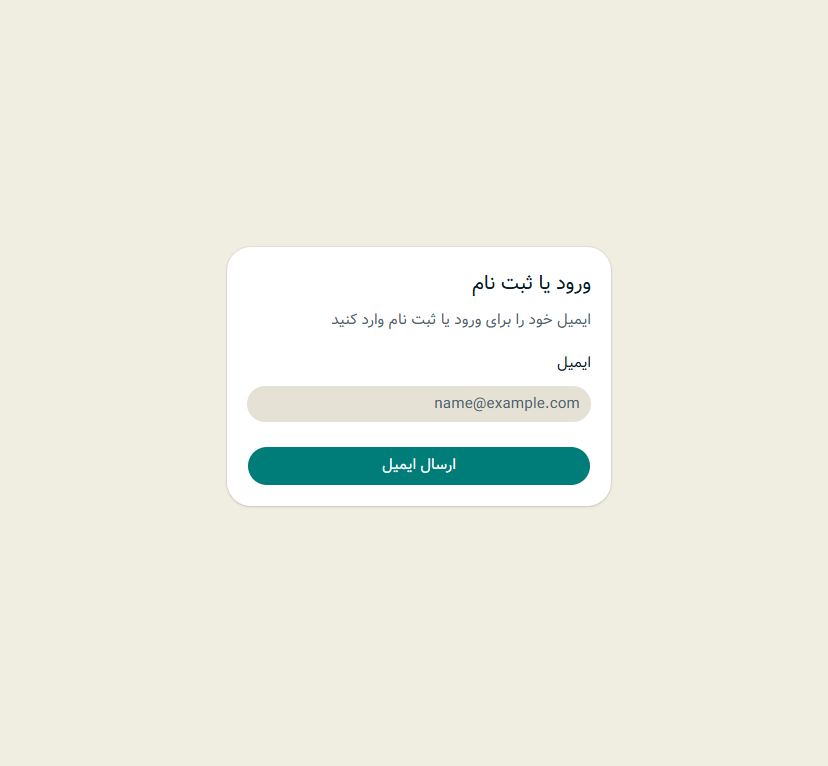
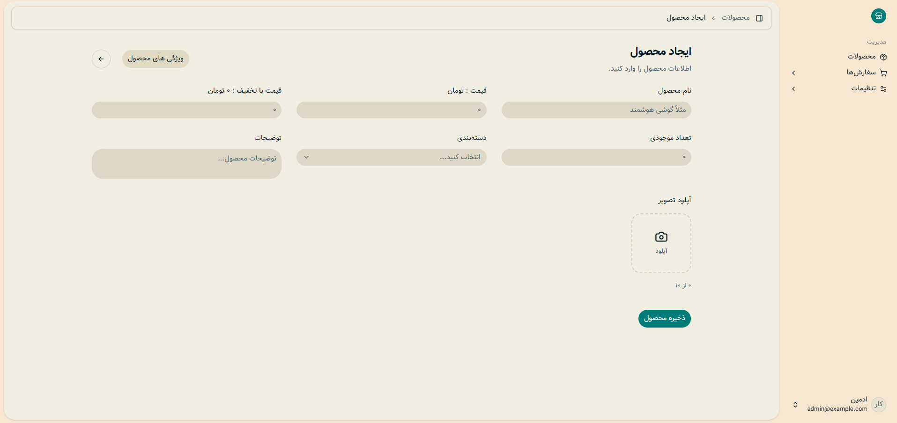

# فروشگاه - در حال توسعه می‌باشد.

یک فروشگاه اینترنتی با ساختار MVP که درحال توسعه می‌باشد و در آینده قراره فیچر های زیادی اد بشه.
**به عنوان یک template خوب ازش استفاده میشه کرد.**

## محتوا

- [ویژگی ها](#ویژگی-ها)
- [در آینده](#در-آینده)
- [ارتباط با من](#ارتباط-با-من)

---
## ویژگی ها

### احراز هویت با ایمیل و OTP
- با استفاده از API سایت هایی مثل render که ایمیل پروایدر هستن انجام میشه.
- **ایمیل تست ادمین و کاربر بن قرار داده شده:
###### admin@example.com
###### ban@example.com
  ###### ***کد تایید این دو ایمیل جهت تست: 123456 ‌***
- **ادمین پنل و پنل کاربری** - هر دو API یکسانی دارند پس نگران مشکلات شلوغی در ساختار نشوید.
### پروفایل کاربری
- حذف ، درج و آپدیت پروفایل کاربر وجود دارد.
- محدودیت حجم عکس پروفایل اعمال شده فکر کنم روی 5 مگابایت (از داخل store/settings.py می‌تونید 
-مقدارش رو تعیین کنید)
- **فعلا باکت تصاویر روی سرور BackBlaze طراحی شده.** (رایگان بود فقط برای همین استفاده کردم)
- ولیدیت های مورد نیاز برای پروفایل انجام شده با regex ولی اگه جایی نیاز به تغییر داشت شخصی سازی کنین.
### محصولات
- حذف ، درج و آپدیت محصول وجود داره.
- عکس ها هم محدودیت تعداد و همچنین محدودیت حجم دارن اینارو بر اساس نیازتون تغییر میتونین بدین.
- موجودیت و قیمت با تخفیف و ... کلی فیچر هست وارد Django-admin بشین میتونین باهاش کار کنین خروجی ساختار رو توی API ببینین.
  
###### *یه مثال می‌ذارم نگید هیچی نگفت.*

**مثال:**
```json
{
  "count": 1,
  "page": 1,
  "page_size": 20,
  "total_pages": 1,
  "results": [
    {
      "id": 1,
      "name": "کتاب قوانین طبیعت انسان اثر رابرت گرین",
      "slug": "کتاب-قوانین-طبیعت-انسان-اثر-رابرت-گرین",
      "category": "کتاب",
      "category_label": "کتاب",
      "description": "این کتاب درباره اینه که چرا آدمها گاهی برخلاف چیزی که میگن رفتار میکنن، چطور احساسات پنهان روی تصمیمهاشون اثر میذاره و چطور میشه الگوهای رفتاری افراد رو بهتر شناخت.",
      "stock": 57,
      "base_price": 39658321,
      "discounted_price": 25444237,
      "images": [
	        {
	          "id": 1,
	          "url": $urladdress$,
	          "alt": "کتاب قوانین طبیعت انسان اثر رابرت گرین"
	        },
	        {
	          "id": 2,
	          "url": $urladdress$,
	          "alt": "کتاب قوانین طبیعت انسان اثر رابرت گرین"
	        }
        ],
	  "is_available": true,
	  "attribute_list": [
        {
          "key": "تعداد صفحات",
          "type": "text",
          "values": [
            "624"]
        }
      ]}
   ]
}

```
## سفارشات
- سفارشات فعلا در حال توسعه است ولی در کل MVP عه و انتظار چیز عجیبی برای اول پروژه نداشته باشید.
- توی فیچر های بعدی بیشتر توسعه میدیم که رابط کاربری بهتری داشته باشه.
- اگه بخش های تکراری یا نامفهوم توی API دیدید تعجب نکنید.**(به نوعی زیر ساخت برای توسعه پروژه هستند.)**
### ادمین پنل
- چندین بخش مختلف تعیین شده براش.مثل:
1. بخش کاربران
2. بخش کالا ها
3. بخش سفارشات
- **فعلا درگیر قسمت های جزئی نشدیم مثل اتصال داینامیک به بقیه API ها یا چیزایی از این قبیل.**

---
## در آینده

- بخش نظرات
- بخش گفتگو آنلاین با مشتری
- اتصال به درگاه پرداخت
- تحلیل داده ها و خرید ها طی یک ماه گذشته و لیست محصولات پر فروش هفته
- و کلی فیچر دیگه که فعلا به ذهنم نمی‌رسه...

---
## تصاویر

<div align="center">
  
  <br><br>
  
</div>

## ارتباط با من

به طور کلی هنوز پروژه در حال توسعه است ولی می‌تونید با تماس با من در تلگرام توی توسعه این پروژه شرکت داشته باشید.
###### [**@CNoox_Bot**](https://t.me/CNoox_Bot)

**هدف کلی این پروژه راحتی جامعه برنامه نویسی و توسعه بخش هایی از سایت های فروشگاهی است که کمتر برنامه نویس ها به اون می‌پردازند.**

⭐ ***با ستاره دادن به پروژه می‌تونین از من و این ریپازیتوری حمایت کنید.***

###### *آخرین آپدیت توضیحات: 10/13/2026*
